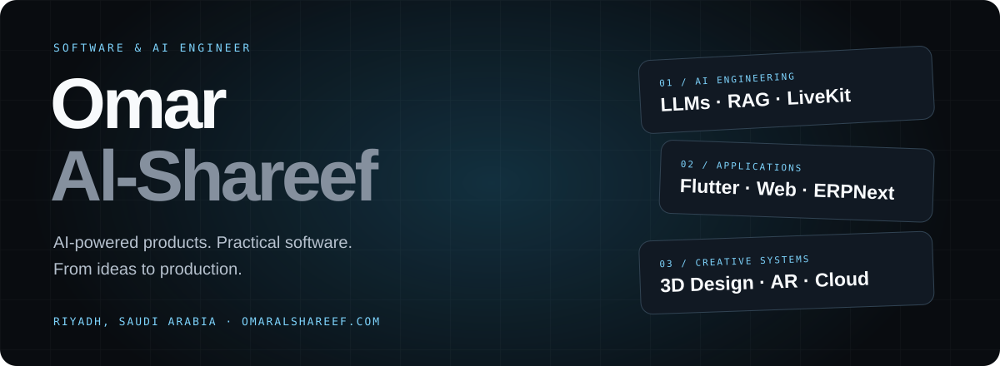
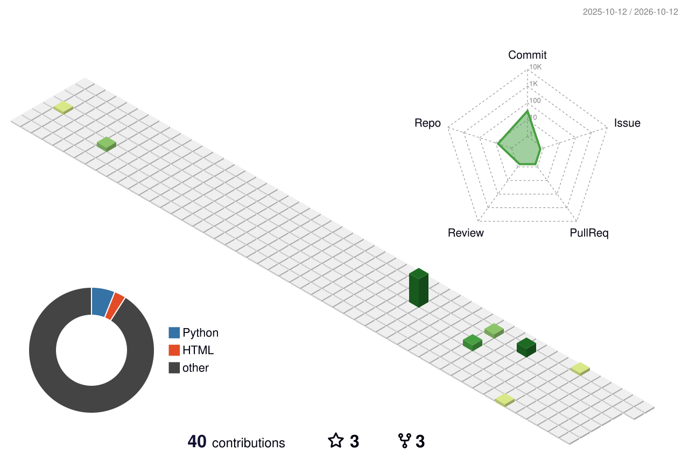

  
  
  
  
  

---

## 01 / About me

I build AI-powered products, retrieval systems, ERP platforms, and mobile apps — turning ideas into production-ready software.

- **AI engineering:** Large Language Models (LLMs), Retrieval-Augmented Generation (RAG), and real-time voice experiences with LiveKit.
- **Applications:** Flutter mobile development, ERPNext & Frappe customization, APIs, and system integration.
- **Creative work:** 3D design and AR experiences with Lens Studio.
- **Infrastructure:** Cloud services and system administration.

## 02 / Tools & technologies

| Area | Technologies |
| --- | --- |
| Languages | Dart · Python · JavaScript · SQL |
| Mobile & web | Flutter · HTML · CSS |
| AI | LLMs · RAG · LangChain · Gemini · LiveKit |
| Business systems | ERPNext · Frappe · APIs |
| Infrastructure | Linux · Docker · Git · MySQL |
| Design | 3D design · Lens Studio |

## 03 / Selected projects

| Project | Focus |
| --- | --- |
| **[Portfolio AI Assistant](https://www.omaralshareef.com/)** | LangChain RAG assistant with document ingestion, embeddings, and vector retrieval over my CV and portfolio |
| **Takamol ERP** | ERPNext for legal operations, workflows, and automation |
| **LSC App** | Mobile platform for legal services |
| **Guess The Flags** | Educational geography game |
| **Snapchat Lenses** | AR experiences built with Lens Studio |

## 04 / GitHub activity

  
Explore my animated 3D contribution chart

  
Generated daily by GitHub Actions. Click the chart to explore my contribution history.

  

---

<strong>Have an idea in mind?</strong> <a href="https://www.omaralshareef.com/">Let’s build something useful.</a>

